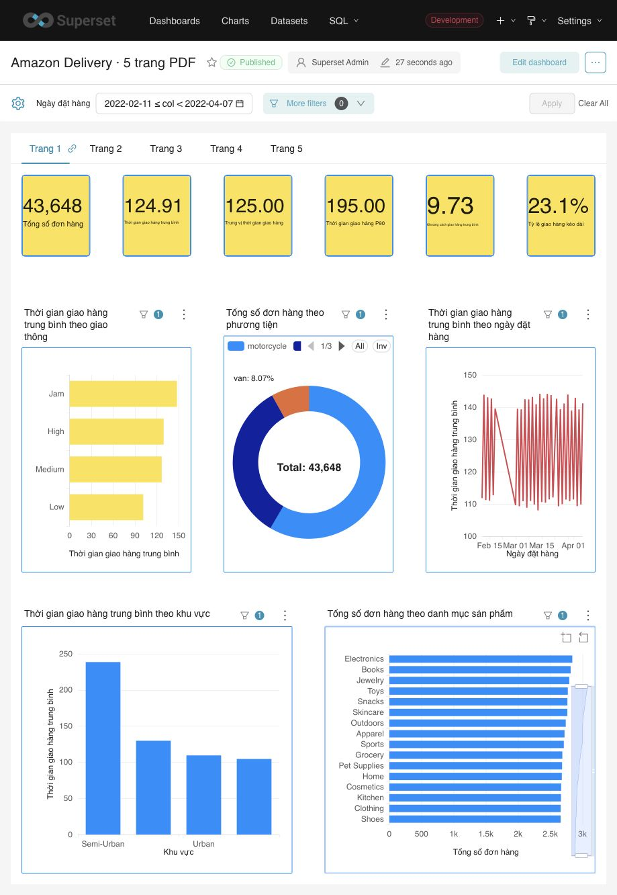

# Amazon Delivery · Apache Superset

Chuyển report Power BI Amazon Delivery thành dashboard Apache Superset với **5 tab, 28 biểu đồ và 6 bộ lọc**, sử dụng PostgreSQL làm nguồn tính toán.

Ngày 23/10/2026: toàn bộ 28 tên biểu đồ, nhãn metric, tên trục và tên bộ lọc đã được Việt hóa. Tên cột kỹ thuật, giá trị danh mục và công thức tính được giữ nguyên. Mapping vẫn lưu tiêu đề Power BI tiếng Anh để đối chiếu nguồn.



## Kết quả

- **43.648 đơn hàng**, từ 11/02 đến 06/04/2022, một dòng mỗi đơn trong bảng nguồn.
- Giao hàng trung bình **124,91 phút**; median **125 phút**; P90 **195 phút**; long delivery rate **23,1%**.
- **168/168** trường hợp chart/filter và **30/30** giá trị hiển thị trong PDF đạt đối chiếu CSV → PostgreSQL → Superset.
- Migration qua REST API theo UUID ổn định; chạy lại không tạo bản sao dashboard/chart/dataset.
- Ma trận tính tổng có trọng số từ từng đơn; có kiểm tra NULL, cohort rỗng và percentile.

Đây là dữ liệu portfolio snapshot 2022, không đại diện cho hoạt động Amazon hiện tại. Kết quả kiểm chứng nằm trong [verification.json](migration/evidence/verification.json).

## Xem dashboard

Dashboard cần một Superset instance đã cấu hình. Trên máy triển khai ban đầu: [mở dashboard local](http://localhost:8088/superset/dashboard/amazon-delivery-intelligence/). Đường dẫn localhost chỉ hoạt động trên máy chạy Superset; repo GitHub không cung cấp bản dashboard web công khai.

Ngày 23/10/2026: đã gỡ bộ 5 dashboard con cũ (11 trang, 55 chart) vì trùng nội dung. Migration không còn tạo lại bộ này. Dashboard chính giữ đủ 5 trang và 28 chart; bản sao khôi phục bộ đã gỡ nằm trong `migration/retired/redundant-children-2026-10-23/`.

Thay thế bằng [Dashboard A · Giao kéo dài và đơn cần kiểm tra](http://localhost:8088/superset/dashboard/amazon-delivery-giao-keo-dai/) gồm 2 trang, 8 biểu đồ/bảng và 4 KPI mới: mức độ kéo dài, Pareto đóng góp, mật độ khoảng cách–thời gian và mức lệch so với nhóm tương đồng. Xem [định nghĩa, phạm vi và kiểm chứng A](docs/dashboard-a.md).

[Dashboard B · So sánh phương tiện cùng điều kiện](http://localhost:8088/superset/dashboard/amazon-delivery-so-sanh-phuong-tien/) gồm 1 trang, 4 biểu đồ/bảng và 3 KPI mới. Cân bằng cơ cấu khu vực × giao thông × thời tiết × khoảng cách cho motorcycle và scooter; mẫu chung gồm 34.281 đơn (91,0%), chênh lệch đã cân bằng +15,60 phút. Đây là liên hệ quan sát, chưa chứng minh tác động của phương tiện. Xem [định nghĩa, phạm vi và kiểm chứng B](docs/dashboard-b.md).

Ảnh các trang: [Trang 1](migration/evidence/screenshots/page-1.png) · [Trang 2](migration/evidence/screenshots/page-2.png) · [Trang 3](migration/evidence/screenshots/page-3.png) · [Trang 4](migration/evidence/screenshots/page-4.png) · [Trang 5](migration/evidence/screenshots/page-5.png).

## Chạy migration

Yêu cầu Python 3.11+, Apache Superset 6.0.0 và PostgreSQL. Bảng `public.amazon_delivery` cần được nạp sẵn từ CSV sạch, với kiểu dữ liệu phù hợp; repo này không chứa pipeline ETL gốc hoặc tự cài Docker stack. Hướng dẫn cấu hình, kiểm chứng và import export nằm trong [tài liệu migration](docs/superset-migration.md#chạy-lại-chính-xác).

```bash
git clone https://github.com/zuzuczung/amazon-delivery-superset.git
cd amazon-delivery-superset
python3 -m venv .venv
. .venv/bin/activate
python -m pip install -r requirements-superset.txt
# Đặt biến môi trường theo .env.example; runner không tự nạp .env.
python migration/scripts/run_migration.py
```

Runner hỏi credential Superset khi chạy; mật khẩu không hiển thị và không được ghi vào repo. Mặc định kết nối môi trường đã kiểm chứng: container `postgres-local`, database `tunglocaldb`, Superset connection ID `2`. Cần điều chỉnh và xác minh các giá trị này cho máy khác.

Kiểm tra ngữ nghĩa metric không cần kết nối database:

```bash
python -m unittest discover -s migration/tests -v
```

## Cấu trúc dự án

| Đường dẫn | Nội dung |
|---|---|
| `data/` | CSV raw 43.739 dòng và CSV sạch 43.648 dòng |
| `reports/` | PDF Power BI gốc và bản report tham khảo |
| `migration/sql/` | View BI bổ sung, không sửa bảng nguồn |
| `migration/scripts/` | Profile, migration, kiểm chứng, export và mapping |
| `migration/tests/` | Kiểm tra ngữ nghĩa percentile, NULL và tổng có trọng số |
| `migration/exports/` | Export Superset chính thức đã thay credential bằng placeholder |
| `migration/evidence/` | JSON kiểm chứng, ảnh dashboard và ảnh PDF nguồn |
| `docs/` | Hướng dẫn, mapping từng visual và QA trình duyệt |

## Nguồn và giới hạn

Bản Superset dùng **5 trang của `amazon_delivery_dashboard.pdf`** và CSV sạch. `amazon_delivery_report.pdf` là bản 6 trang có KPI khác, chỉ giữ để tham khảo. Không có PBIX/PBIP, DAX hoặc Power Query gốc, nên kiểm chứng snapshot không chứng minh tương đương mọi filter context Power BI. Một số sắp xếp, tooltip và hành vi hiển thị khác nhau; xem [mapping](docs/visual-mapping.md) và [QA](docs/browser-QA.md).

Project được tạo độc lập từ thư mục Amazon có sẵn trên máy, không kế thừa lịch sử commit của repo Power BI cũ. Phạm vi chuyển đổi, dữ liệu, làm sạch, phân tích và diễn giải được ghi theo khung 5 bước trong [tài liệu bàn giao](docs/superset-migration.md).
